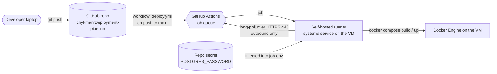
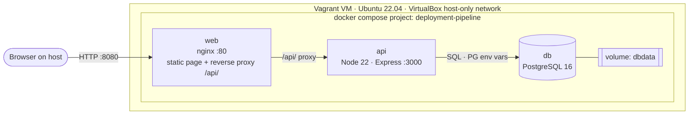

# Architecture snapshot 00: baseline (before Task 1)

## 1. Delivery path

## 2. Runtime (inside the Vagrant VM, 192.168.56.10)

Only `web` publishes a port. `api` and `db` are reachable only on the compose network.

## 3. Properties of this design

| Property | Today |
|----------|-------|
| Availability | Single VM, single instance of each service: **no redundancy** |
| Deploy method | Push-based, `docker compose down` then `up`: a few seconds of **downtime per deploy** |
| Rollback | Re-run an older commit by hand: **no fast rollback** |
| Testing before merge | **None**: pushes to `main` deploy directly |
| Observability | `docker logs` only: **no metrics, no alerts** |
| Secrets | One GitHub repo secret, injected as an env var |
| State | One Postgres volume on the VM disk, **no backups** |
| Trust boundary | The runner executes workflow code with Docker access: fork PRs must never reach it |

## 4. What each upcoming task changes

| Task | Boxes it adds or moves |
|------|------------------------|
| 1. CI quality gates | A CI stage on GitHub-hosted runners in front of `main` (tests, lint, scan) |
| 2. Release engineering | A container registry between CI and the VM; blue/green web tier; rollback |
| 3. Observability | Prometheus, Grafana, Loki beside the app |
